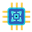

## Hi there 👋

I'm an electrical engineer ⚡ by training who graduated when computer science and computer engineering were newish. My first coding experience was BASIC  and Assembler   on 8-bit machines 🌈, followed by Pascal  and Visual Basic . These days I've left the world of hardware far behind and focus on software 👨‍💻 with a real-world flavour at work.

When at home I have many hobbies and coding is now one of them. My hobbies include 3D printing 🖨️ and IoT. Other activities include Home Assistant , IP networking, WiFi   🛜, model railways 🚂, Raspberry Pi , ESP32 , Flight tracking ✈️,... I also do outdoor things like boating 🚤, construction 🪚, skiing 🎿 & hiking 🥾.

## What I make

When I 3D print I like to develop customisable useful objects. To achieve this I work with OpenSCAD  to generate parameterised 🛠️ models. The end consumer of a model can then adjust the output to produce what they need. The models are typically made with useful features, selectable content 📋, error checked ⚠️ and auto scaled 📐. I print test all designs, although there are often so many variants I can't test them all 🤷‍♂️.

In terms of license, if the code is for creating 3D prints, the printed outputs are usually CC BY-NC-ND  licensed. The code to generate the models I typically keep in a private repo to avoid licensing issues and people selling my prints, or I may use Polyform Non-Commercial  or Dual licensing. This will be clear in any repo. While I am a fan of FOSS the world is changing so now I am more on the page of 'source available' and a clear license helps all involved.

No reference to 3rd parties suggests any endorsement by them.

## How I work

I code for different purposes, but one of the major reasons is to enhance my 3D printing hobby. I've really taken to AI-boosted 🤖 coding for this, using a combo of Claude  and ChatGPT . My productivity has leapt upwards, focusing on measurable outcomes in physical models, not code.

For the 3D-printing projects I test and check the output rigorously, including print tests at several interim stages and reading the code. Vibe coding does not work in this scenario as the tools are quite creative in their visualisations. I also try to test all my other projects carefully and I tend to do micro releases and test in increments.

My usual methodology is to create a master code file with all variants, together with Python  + config files + TOML  to create simpler sub-variants from the master and to pass parameters between dependent parts. That way I can run a master branch and keep the derivatives up to date.

## Gear

Currently I have two 3D printers, although mostly I use a Bambu Lab  P1S with AMS as it is the most reliable, so I can focus on designing, not tinkering with the machine. I used to use a Creality  Ender-3 Pro connected to OctoPrint , which I love, but the machine itself was too much work to maintain over time.

I have a range of IoT devices from the Tuya  ecosystem, Deco  Wi-Fi , Tapo  cameras, RPIs 3 & 4  ,...

## Learnings

I am currently working on several parallel projects. What I have learnt in the last year is that AI (mostly Claude ) has really boosted the amount of progress and fun I can have. As now I code in small bursts, make micro contributions, automate my workflow and test in small increments. Pretty much what 'agile' was supposed to do, except Claude and I are our own cross functional team.

I am the product owner/manager/engineer and Claude is the coder/tester/devops. In the past there was a barrier to starting a day of coding, reserving enough time, remembering where I was... Now I can make small pieces of progress any time. Lets see what this looks like in a year.

## Activity overview

*Generated daily with my own stats generator. Only used for fun and definitely not 'official' or intended to stress accomplishments or volume so I am reluctant to publish. I use it for my own entertainment and a practical purpose. I am experimenting with how AI can alter and boost the process of SW development via my own hobby projects. Hence I am using Claude code, micro-coding and end to end automation of my workflows.

So the reason for generating this was to determine the impact of AI on my coding habits in a data driven manner, as well as the qualitiative boost of being a happier coder. Hence here I publish relative numbers not absolute numbers where I can. If you really like this, message me and I might consider making it a 'public repo' for others to use*

<picture>
  <source media="(prefers-color-scheme: dark)" srcset="https://raw.githubusercontent.com/elentophanes/elentophanes/main/stats/activity-dark.svg?v=844cc554130b6da384d17aa7de69968e64f54e3ccd9a11184b0c93b3b2a840ee">
  <source media="(prefers-color-scheme: light)" srcset="https://raw.githubusercontent.com/elentophanes/elentophanes/main/stats/activity-light.svg?v=b8494a43c1776c69b5f877ff89e6bff73d819e90a4f387d438baf6607f48f8f7">
  
</picture>
<picture>
  <source media="(prefers-color-scheme: dark)" srcset="https://raw.githubusercontent.com/elentophanes/elentophanes/main/stats/activity-habits-dark.svg?v=9d04c9d755982fc7175b7bc9d29e0bb0d227b375cd71afa142f792202e5314f0">
  <source media="(prefers-color-scheme: light)" srcset="https://raw.githubusercontent.com/elentophanes/elentophanes/main/stats/activity-habits-light.svg?v=e2d01cf960935c99b74077bbca302c3281d10bd8cdefc5ac7bf25ff37ede0e43">
  
</picture>
<picture>
  <source media="(prefers-color-scheme: dark)" srcset="https://raw.githubusercontent.com/elentophanes/elentophanes/main/stats/activity-badges-dark.svg?v=8369aebb30b176a5dd7dc4e000dcd457b4c014d49aee40e953f4a520c1c6a4a7">
  <source media="(prefers-color-scheme: light)" srcset="https://raw.githubusercontent.com/elentophanes/elentophanes/main/stats/activity-badges-light.svg?v=4e288474eb528790cfcb1056938424151b58f07f5c4aebe3785dea68579d6a55">
  
</picture>
<picture>
  <source media="(prefers-color-scheme: dark)" srcset="https://raw.githubusercontent.com/elentophanes/elentophanes/main/stats/activity-records-dark.svg?v=89e89baf18322a58ab1be666bd27f68d5a11758fdf636155b5e330431cbb4464">
  <source media="(prefers-color-scheme: light)" srcset="https://raw.githubusercontent.com/elentophanes/elentophanes/main/stats/activity-records-light.svg?v=d04f118d7a226331692a91d7e6e5898e05fc918190b985d2c227351cc8ce0e57">
  
</picture>
<picture>
  <source media="(prefers-color-scheme: dark)" srcset="https://raw.githubusercontent.com/elentophanes/elentophanes/main/stats/activity-compare-dark.svg?v=e3d9fd82d5172990d6d84c2436296432f7fff173f09aecde40a06611c419c3a4">
  <source media="(prefers-color-scheme: light)" srcset="https://raw.githubusercontent.com/elentophanes/elentophanes/main/stats/activity-compare-light.svg?v=69923d0cc31d6e46d54564284eb2e0cbb3d1db5f1adf52be8ab14eb2778c3286">
  
</picture>
<picture>
  <source media="(prefers-color-scheme: dark)" srcset="https://raw.githubusercontent.com/elentophanes/elentophanes/main/stats/activity-review-dark.svg?v=09cca6c641e6a03668a32c59a6eaad7ef7167eb33db8cc05942918b9758df703">
  <source media="(prefers-color-scheme: light)" srcset="https://raw.githubusercontent.com/elentophanes/elentophanes/main/stats/activity-review-light.svg?v=09cca6c641e6a03668a32c59a6eaad7ef7167eb33db8cc05942918b9758df703">
  
</picture>
<!--
**elentophanes/elentophanes** is a ✨ _special_ ✨ repository because its README.md (this file) appears on your GitHub profile.

Here are some ideas to get you started:

- 🔭 I’m currently working on ...
- 🌱 I’m currently learning ...
- 👯 I’m looking to collaborate on ...
- 🤔 I’m looking for help with ...
- 💬 Ask me about ...
- 📫 How to reach me: ...
- 😄 Pronouns: ...
- ⚡ Fun fact: ...
-->

